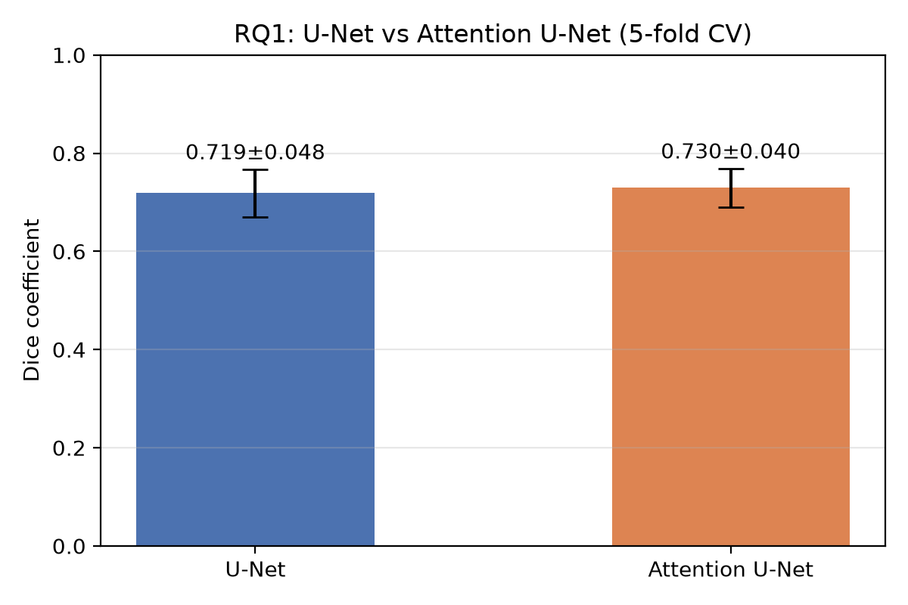
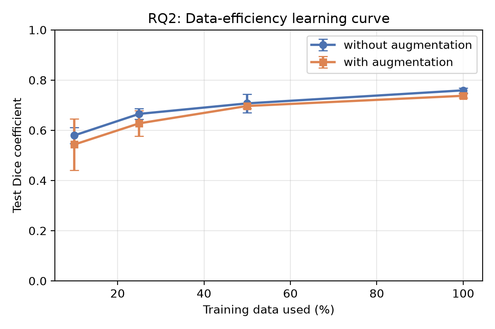
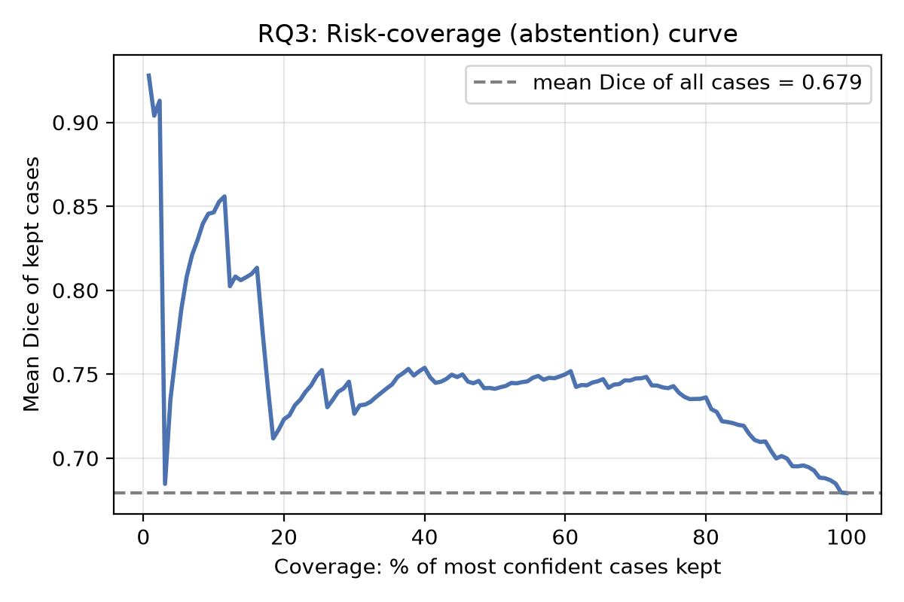
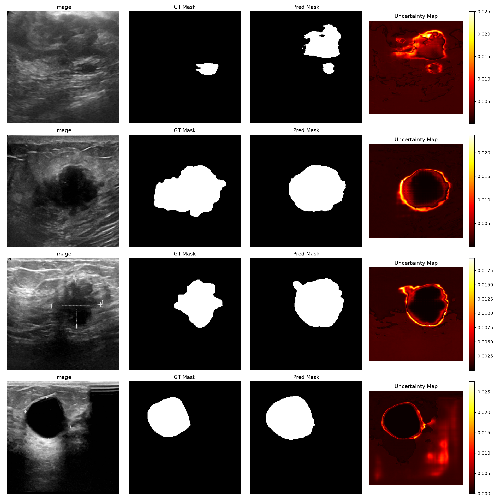

# Data-Efficient and Uncertainty-Aware Breast Ultrasound Lesion Segmentation with U-Net

**SDSC 6018 · 2026/2027 Fall · Final Project · Group 13**

Members: ZHANG Hanyu (60315169) · XIE Jiaxu · XUE Hezong · LIU Xinyu

---

## Overview

This project studies breast ultrasound lesion segmentation with U-Net from three angles:

- **RQ1 — Model comparison.** How well does a from-scratch U-Net segment breast lesions, and do attention gates help? (Stratified 5-fold cross-validation: U-Net vs. Attention U-Net.)
- **RQ2 — Data efficiency.** How much annotation is enough for a usable model? (Learning curve over nested training subsets of 10 / 25 / 50 / 100%, 3 seeds, augmentation on/off — 24 training runs.)
- **RQ3 — Trust calibration.** When can the model say "I don't know"? (MC Dropout, T = 20 stochastic passes, uncertainty averaged over the predicted lesion region, plus an abstention / risk–coverage analysis.)

## Headline results

| Experiment | Finding |
|---|---|
| RQ1 | Attention U-Net Dice **0.730 ± 0.040** vs. plain U-Net **0.719 ± 0.049** (IoU 0.581 vs. 0.569); attention wins 4 of 5 folds |
| RQ2 | Dice climbs 0.580 → 0.665 → 0.707 → 0.759 as data grows 10 → 25 → 50 → 100%; **50% of the data (~195 images) already passes the Dice 0.70 usability line (93% of full-data performance)** |
| RQ3 | Lesion-focused uncertainty correlates with per-case Dice (Spearman **−0.54**, p = 3.1 × 10⁻¹¹) vs. −0.25 for a naive whole-image average; referring the less-confident half of cases to review cuts the automated failure rate from **29.2% to 10.8%** |

| RQ1: model comparison | RQ2: learning curve |
|---|---|
|  |  |

| RQ3: risk–coverage curve | RQ3: uncertainty maps (top row: a failure case) |
|---|---|
|  |  |

## Repository structure

```
busi-unet-segmentation/
├── README.md
├── requirements.txt
├── src/
│   ├── train_experiments.py   # all RQ1/RQ2/RQ3 training + evaluation runs
│   ├── analyze_results.py     # regenerates summary tables and all four figures from the CSVs
│   └── fix_rq3_metrics.py     # recomputes lesion-focused uncertainty metrics from the saved checkpoint
├── results/
│   ├── figures/               # final figures used in the report
│   └── tables/                # per-run and summary CSVs (incl. data manifest)
└── Dataset_BUSI_with_GT/      # NOT included — download separately (see below)
```

## Setup

1. Python 3.10+ with a CUDA-capable GPU recommended (all runs here used a single RTX 5070-class GPU).
2. Install dependencies:

```bash
pip install -r requirements.txt
```

3. Download the **BUSI (Breast Ultrasound Images)** dataset — 780 grayscale ultrasound images (437 benign, 210 malignant, 133 normal) with expert pixel masks, from Baheya Hospital, Cairo (Al-Dhabyani et al., 2020, *Data in Brief*, 28, 104863). It is mirrored on Kaggle. Place it so the folder layout is:

```
busi-unet-segmentation/Dataset_BUSI_with_GT/{benign,malignant,normal}/*.png
```

(Or set the environment variable `BUSI_DATA_DIR` to wherever you put it.)

## Reproducing the results

```bash
# 1. Train everything (RQ1 5-fold CV × 2 models, RQ2 24-run learning curve,
#    RQ3 dropout model + MC evaluation). Writes rq1_results.csv, rq2_results.csv,
#    rq3_cases.csv and the checkpoint next to the script.
python src/train_experiments.py

# 2. (Optional) Recompute the lesion-focused uncertainty metrics in rq3_cases.csv
#    from the saved checkpoint without retraining.
python src/fix_rq3_metrics.py

# 3. Regenerate the summary tables and all figures from the CSVs.
python src/analyze_results.py
```

Notes:

- The ~125 MB model checkpoint (`rq3_attunet_dropout.pth`) is excluded from this repository (GitHub file-size limit); it is regenerated by step 1.
- `results/tables/manifest.csv` is the dataset audit produced by step 1 (image ↔ mask pairing, including the 17 double-annotated images merged by mask union).
- All splits are stratified on the benign:malignant ratio. BUSI releases no patient identifiers, so splitting is at the image level — see the report for the limitations discussion.

## References

- Al-Dhabyani, W. et al. (2020). Dataset of breast ultrasound images. *Data in Brief*, 28, 104863.
- Ronneberger, O. et al. (2015). U-Net: Convolutional networks for biomedical image segmentation. *MICCAI*.
- Oktay, O. et al. (2018). Attention U-Net: Learning where to look for the pancreas. *MIDL*.
- Gal, Y. & Ghahramani, Z. (2016). Dropout as a Bayesian approximation: representing model uncertainty in deep learning. *ICML*.
